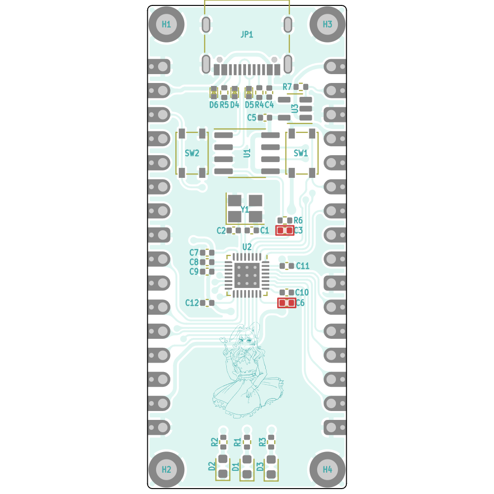
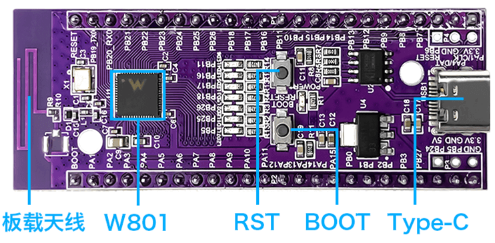
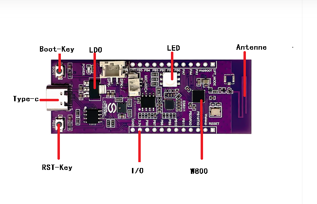
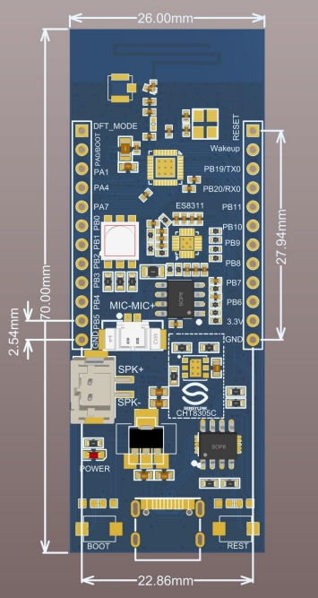
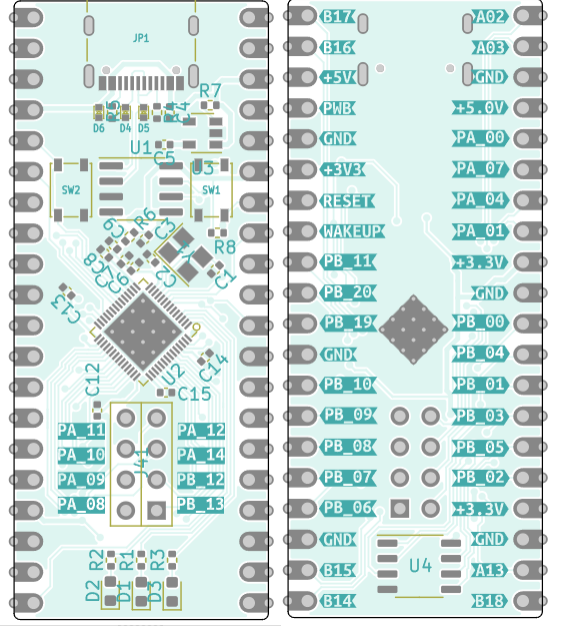

# Winner Micro W80x Projects

WM IoT SDK (`winnermicro/wm_iot_sdk`) projects for Winner Micro W80x
development boards.

This repository is organized **per board**: every board has its own directory
with its `README.md`, hardware notes, build/flash instructions and the
projects that run on it.

## Boards

| Board | Directory | SoC | CPU | Wireless | Flash |
|-------|-----------|-----|-----|----------|-------|
| W800-nano (Air101-nano) | [`w800-nano/`](w800-nano/) | W800 (C-SKY XT804) | up to 240 MHz | none (RF not populated) | 2 MB |
| HLK-W801-KIT | [`hlk-w801-kit/`](hlk-w801-kit/) | W801 (C-SKY XT804) | up to 240 MHz | WiFi 4 + BLE 4.2 | 2 MB |
| HLK-W800-KIT | [`hlk-w800-kit/`](hlk-w800-kit/) | W800 (C-SKY XT804) | up to 240 MHz | WiFi 4 + BLE 4.2 | 2 MB |
| W806-nano (Air103-nano) | [`w806-nano/`](w806-nano/) | W806 / Air103 (C-SKY XT804) | up to 240 MHz | none (no RF) | **1 MB** |
| HLK-W806-KIT | [`hlk-w806-kit/`](hlk-w806-kit/) | W806-C200 (C-SKY XT804) | up to 240 MHz | none (no RF) | **1 MB** |

## Board images











## Projects

Each board directory contains the projects built for that board. See the
board's `README.md` for details on building, flashing and expected output.

## Building

`build.sh` (repo root) is a bash helper for **Git Bash / MSYS / Cygwin** that
sets up the WinnerMicro CLI environment and forwards to `wm.py`. Run it from
inside a project directory:

```bash
cd w806-nano/blink_hello
../../build.sh build                 # configure + build
../../build.sh flash -p COM36        # build + flash APP ONLY (fast)
../../build.sh flash-full -p COM36   # build + FULL flash (partition table + bootloader + app)
../../build.sh monitor -p COM36      # serial monitor
```

The bootloader and partition table are fixed SDK artifacts (byte-identical
across all projects and boards), so `flash` sends only the app image by
default. Use `flash-full` after putting a fresh board on the bench or after an
SDK update. An explicit `-n`/`--name` argument overrides the app-only default.

See each board's `README.md` for the full manual environment setup and the
exact COM port / flashing notes.

> Wireless summary: the **HLK-W801-KIT** and **HLK-W800-KIT** have the RF stack
> populated (use them for Wi-Fi / BLE). The W800-nano, W806-nano and
> HLK-W806-KIT are MCU-only. The two W806 boards have only **1 MB flash**, so
> their projects use a custom partition table (`partition_table_custom.csv`)
> to fit inside 1 MB.
