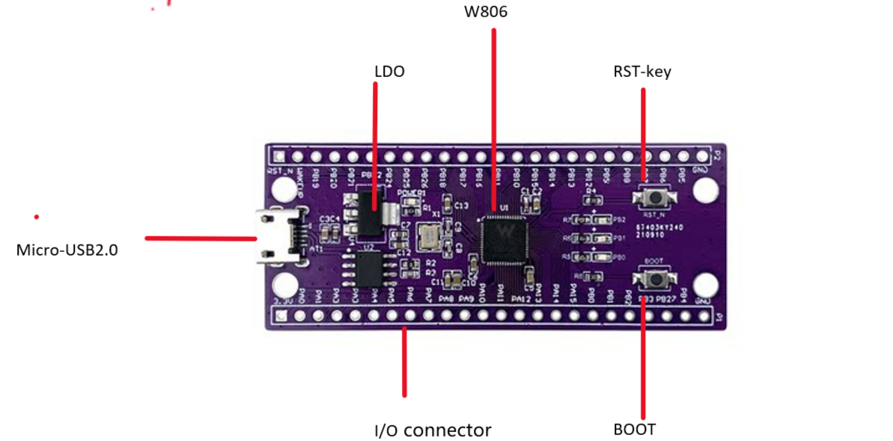

# HLK-W806-KIT

The **HLK-W806-KIT** (Hi-Link / 海凌科 W806 development kit) is an **MCU-only**
board built around the **WinnerMicro W806-C200** — the 1 MB-flash member of the
W80x family. It has **no wireless** and the on-board **PSRAM is not
populated**.

## Key facts

| Aspect | Value |
|--------|-------|
| SoC | WinnerMicro W806-C200 (QFN56, 6×6 mm) |
| CPU | 32-bit C-SKY XT804, up to **240 MHz** (`-mcpu=ck804ef`) |
| Memory | **1 MB SPI flash**, 288 KB RAM (160 KB SRAM + 128 KB DRAM) |
| Wireless | **None** (MCU-only, no RF) |
| PSRAM | On-board PSRAM **not populated** |
| USB bridge | CH340 (Micro-USB), **115200 8N1** |
| Console | UART0 on PB19(TX) / PB20(RX) |
| Download mode | **RST only**: press **RST** when the tool prompts `please reset device` (no BOOT needed) |
| LEDs | 3 on-board LEDs on **PB0 / PB1 / PB2**, **LOW-active** |

## Board photo



## LEDs (LOW-active: GPIO low = LED on)

| LED | W806 pin | GPIO num |
|-----|----------|----------|
| LED1 | PB0 | `WM_GPIO_NUM_16` |
| LED2 | PB1 | `WM_GPIO_NUM_17` |
| LED3 | PB2 | `WM_GPIO_NUM_18` |

```c
wm_drv_gpio_data_reset(pin); /* LED on  */
wm_drv_gpio_data_set(pin);   /* LED off */
```

## 1 MB flash — custom partition table (important)

Same as the W806-nano: the W806 has only **1 MB flash**, but the SDK's default
partition tables assume 2 MB. Every project ships a project-local
`partition_table_custom.csv` (enabled by `CONFIG_WM_PARTITION_TABLE_CUSTOMIZATION=y`)
giving the app a **~900 KB** partition inside 1 MB.

## Download mode (press RST when prompted — no BOOT needed)

Unlike the W806-nano, the HLK-W806-KIT's CH340 DTR/RTS lines are **not** wired
to auto-enter the bootloader (`wm.py flash` alone cannot reset it into
download mode). However, the ROM **secboot enters download mode when it
catches the ESC stream** that the flash tool sends, so you only need to
**reset the chip while the tool is waiting**:

1. Run `build.sh flash -p COM42` (or `flash-full`).
2. The tool builds, connects, then prints **`please reset device`** — it is
   now sending ESC and waiting ~60 s.
3. Press-and-release **RST** (no BOOT button needed).
4. The secboot catches the ESC, enters download mode, and the tool syncs and
   flashes.

So a normal flash session is: *start the command → wait for
`please reset device` → press RST once*. No BOOT button required.

> The board does **not** auto-reset into the app after flashing, so for a
> clean boot log (frequency, etc.) press **RST** once after flashing.

### Why no BOOT is needed

The W806 ROM secboot ("Secboot …" banner) listens on UART0 during its startup
window. When it sees `ESC` (0x1b) — which `wm.py flash` sends continuously
while waiting to sync — it jumps into the ROM XMODEM downloader (it prints
`[I] ESC pressed` / `[E] to rom …` and starts emitting `C`). Holding BOOT is
only one way to reach the secboot; a plain reset that lets the secboot see the
ESC works just as well. This is the same mechanism the W806-nano uses, except
there the CH340's DTR physically resets the chip automatically.

### build.sh now handles the build/ dir

`build.sh` auto-cds up to the project folder, so running it from inside
`build/` also works (e.g. `cd hlk-w806-kit/blink_hello/build && ../../../build.sh build`).

## Projects

| Project | Purpose |
|---------|---------|
| [`blink_hello`](blink_hello/) | Blink the 3 LEDs + print system frequency |
| [`dhry_240m`](dhry_240m/) | Dhrystone 2.1 @ 240 MHz |
| [`coremark_240m`](coremark_240m/) | CoreMark 1.0.1 @ 240 MHz |

### Measured results (GCC 6.3.0, 240 MHz)

**`dhry_240m`** (2,000,000 runs, `register` attribute):

```
Microseconds for one run through Dhrystone: 1.465
Dhrystones per Second:                      682361.0
Score (DMIPS/MHz):                          1.618
```

**`coremark_240m`** (7200 iterations):

```
Iterations/Sec   : 661.10
CoreMark 1.0 : 661.096318 / GCC 6.3.0 -Ofast -funroll-all-loops -fgcse-sm -finline-limit=500 -fno-schedule-insns / Static
Score (CoreMarks/MHz): 2.75
```

## Dependencies

- **WM IoT SDK** (CMake-based build system, `tools/wm/wm.py`).
  On this machine: `D:\board_database\main-air101-w801\wm_iot_sdk`
  (set as the `WM_IOT_SDK_PATH` environment variable).
- **WinnerMicro CLI Compile Suite**: bundled C-SKY toolchain
  (`csky-elfabiv2-gcc`, T-HEAD C-SKY Tools V3.10.29 / GCC 6.3.0), CMake,
  Ninja, ccache and Python. On this machine: `D:\winnermicro\wmclics`.
- CH340 USB-UART driver (board console / flashing bridge).

## Building and flashing

Every build must run with the CLI compile suite's tools on `PATH` so that
`cmake`, `ninja`, `python` and the C-SKY toolchain resolve correctly.

**Quick way (bash / Git Bash / MSYS):**

```bash
cd hlk-w806-kit/blink_hello
../../build.sh build                 # configure + build
../../build.sh flash -p COM42         # build + flash APP ONLY (fast)
../../build.sh flash-full -p COM42    # build + FULL flash (pt + bootloader + app)
../../build.sh monitor -p COM42      # serial monitor
```

**Manual way (PowerShell):**

```powershell
# 1. Prepare the environment (once per shell)
$env:WM_IOT_SDK_PATH = "D:\board_database\main-air101-w801\wm_iot_sdk"
$tool = "D:\winnermicro\wmclics"
$env:PATH = "$tool;$tool\ccache;$tool\cmake\bin;$tool\ninja;$tool\python;$tool\python\Scripts;$tool\toolchain\csky-elfabiv2-tools\bin;$env:PATH"
$env:PYTHONPATH = "$tool\python\lib\site-packages"

# 2. Build a project
cd hlk-w806-kit\blink_hello
python $env:WM_IOT_SDK_PATH\tools\wm\wm.py build

# 3. Run the flash, then when it prints "please reset device", press RST:
python $env:WM_IOT_SDK_PATH\tools\wm\wm.py flash -p COM42

# 4. Watch the console output (press RST on the board for a fresh boot log)
python $env:WM_IOT_SDK_PATH\tools\wm\wm.py monitor -p COM42
```

Notes:

- This board's COM port may differ from other boards (e.g. `COM42` here).
  Confirm the right port with the W80x `Secboot V0.6` + `C` handshake after
  entering download mode.
- If you change `prj.config`, delete the project's `build/` folder first so
  the Kconfig re-runs (otherwise the change is silently ignored).
- Benchmark projects disable the hardware watchdog at startup and loop with a
  10 s pause between runs.
