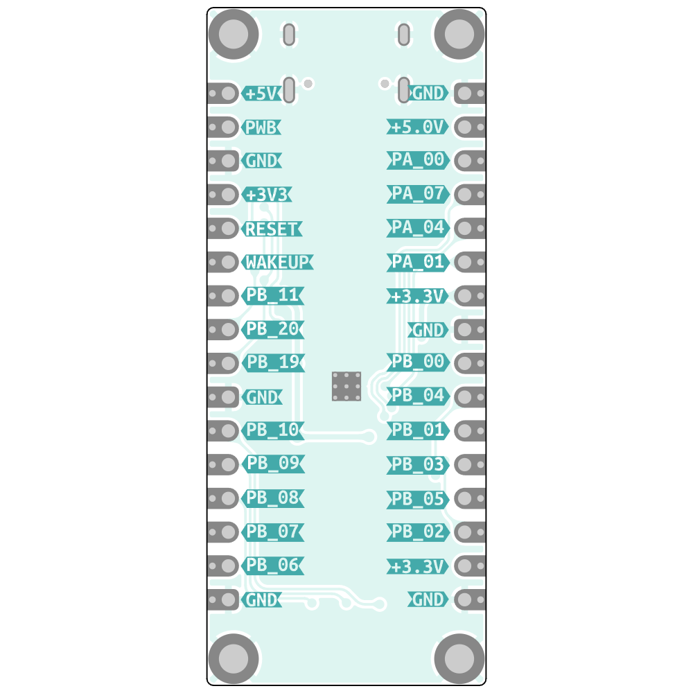
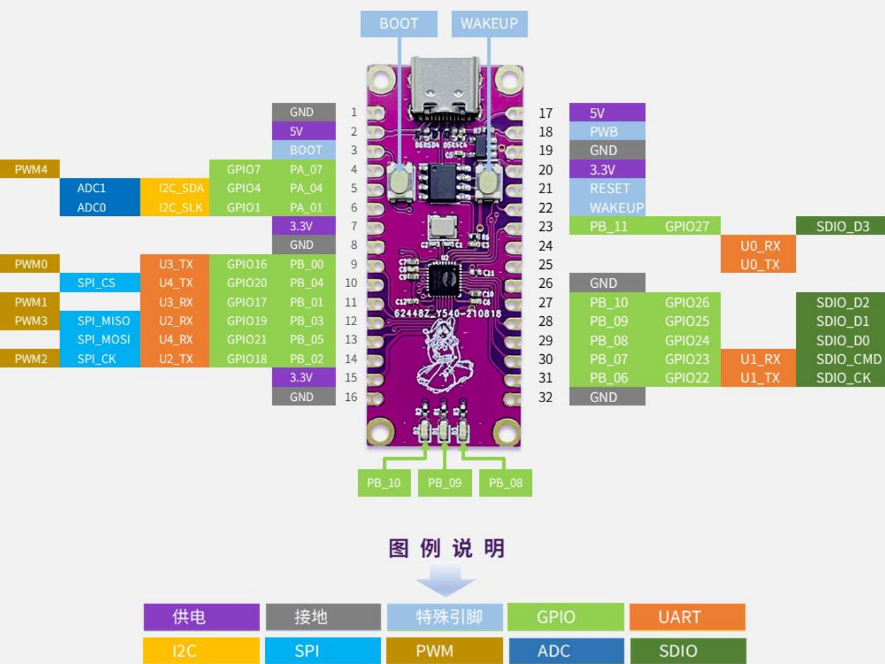

# W800-nano (Air101-nano)

The **W800-nano** (also sold as the *Air101-nano*, schematic
`Air101-Core-Board V1.0`) is an MCU-only board built around the
**WinnerMicro W800** SoC. The W800's Wi-Fi/BLE RF path is **not populated**,
so only the MCU peripherals are usable.

## Board photos






## Key facts

| Aspect | Value |
|--------|-------|
| SoC | WinnerMicro W800 (QFN32, 4×4 mm) |
| CPU | 32-bit C-SKY XT804, up to **240 MHz** (`-mcpu=ck804ef`) |
| Memory | 2 MB SPI flash, 288 KB RAM |
| Wireless | Wi-Fi/BLE **not populated** (MCU-only board) |
| USB bridge | CH330N (CH340-class), **115200 8N1** |
| Console | UART0 on PB19(TX) / PB20(RX) |
| Download mode | CH340 DTR/RTS auto-reset into W800 secboot, XMODEM (`wm.py flash`) |
| LEDs | 3 on-board LEDs on **PB8 / PB9 / PB10**, **high-active** |

## Memory (RAM) �?full 288 KB is usable in pure C

The W800 has **288 KB RAM** = **160 KB SRAM** (`0x20000000`) + **128 KB DRAM**
(`0x20028000`).

| | Size | Region |
|---|---|---|
| SRAM | 160 KB | `0x20000000` |
| DRAM | 128 KB | `0x20028000` |
| **Total** | **288 KB** | |

The LuatOS/Air101 doc says *"Lua 可用内存 176�?32 KB，默�?176 KB"* �?that is the
memory LuatOS exposes to the **Lua VM** (the `luat_heap`), after LuatOS
reserves a large pool for the Lua runtime (VM, GC heap, filesystem, Lua
state). It is **not** the chip's total RAM and does **not** limit a bare C
program.

In the WM IoT SDK both SRAM and DRAM are registered with the C heap
(`wm_heap`, both `WM_HEAP_CAP_DEFAULT`), so `malloc` can use the full 288 KB.
Measured free heap at boot (blink_hello):

```
[I] (3) main: heap size 272688(266.30KB)
```

So a pure C application starts with **~266 KB free heap** (~272 KB on the
w801-kit measured with WiFi off); the remaining ~16�?8 KB is FreeRTOS kernel +
task/ISR stacks + the image's `.data`/`.bss` + heap metadata. With WiFi
enabled the stack reserves extra buffers (measured ~258 KB free).

> Caveat: SRAM also holds your code/data/stack and supports code execution;
> DRAM is fully heap and is shared CPU+DMA.

## Pin map (relevant subset)

| Net | W800 pin | GPIO num |
|-----|----------|----------|
| LED1 | PB8  | `WM_GPIO_NUM_24` |
| LED2 | PB9  | `WM_GPIO_NUM_25` |
| LED3 | PB10 | `WM_GPIO_NUM_26` |
| UART0 TX | PB19 | `WM_GPIO_NUM_35` |
| UART0 RX | PB20 | `WM_GPIO_NUM_36` |

## LED polarity �?verified HIGH-active (important)

The three LEDs are **high-active**: driving the GPIO **high** turns the LED on.

```
GPIO ── 5.1kΩ ── LED anode ── LED cathode ── GND      �? HIGH = LED on
```

Evidence (official schematic `20210910182802476_Air101-Board_v1.0.pdf` and the
KiCad netlist behind `https://wiki.luatos.org/_static/bom/Air101.html`):

- Netlist, per LED D1/D2/D3: **Pad1 �?`GND`**, **Pad2 �?`Net-(Dx-Pad2)` �?  R (5.1kΩ) �?W800 GPIO** (`/PB_09`, `/PB_10`, `/PB_08`).
- For a normal LED to conduct, the anode must sit at a higher potential than
  the cathode. With the GND-side pad as the **cathode** and the
  GPIO-through-resistor pad as the **anode**, the LED only conducts when the
  GPIO is high.

In code:

```c
wm_drv_gpio_data_set(pin);   /* LED on  */
wm_drv_gpio_data_reset(pin); /* LED off */
```

> The schematic alone can be ambiguous (net labels instead of wires, and the
> LED symbol orientation), so this is pinned down with the authoritative KiCad
> netlist above.

## Projects

| Project | Purpose |
|---------|---------|
| [`blink_hello`](blink_hello/) | Blink the 3 LEDs + print system frequency |
| [`dhry_240m`](dhry_240m/) | Dhrystone 2.1 @ 240 MHz |
| [`coremark_240m`](coremark_240m/) | CoreMark 1.0.1 @ 240 MHz |

### Measured results (GCC 6.3.0, 240 MHz)

**`dhry_240m`** (2,000,000 runs, `register` attribute):

```
Microseconds for one run through Dhrystone: 1.440
Dhrystones per Second:                      694203.4
Score (DMIPS/MHz):                          1.646
```

**`coremark_240m`** (7200 iterations):

```
Iterations/Sec   : 660.73
CoreMark 1.0 : 660.732312 / GCC 6.3.0 -Ofast -funroll-all-loops -fgcse-sm -finline-limit=500 -fno-schedule-insns / Static
Score (CoreMarks/MHz): 2.75
```

## Dependencies

- **WM IoT SDK** (CMake-based build system, `tools/wm/wm.py`).
  On this machine: `D:\board_database\main-air101-w801\wm_iot_sdk`
  (set as the `WM_IOT_SDK_PATH` environment variable).
- **WinnerMicro CLI Compile Suite**: bundled C-SKY toolchain
  (`csky-elfabiv2-gcc`, T-HEAD C-SKY Tools V3.10.29 / GCC 6.3.0), CMake,
  Ninja, ccache and Python. On this machine: `D:\winnermicro\wmclics`.
- CH340 USB-UART driver (board console / flashing bridge).

## Building and flashing

Every build must run with the CLI compile suite's tools on `PATH` so that
`cmake`, `ninja`, `python` and the C-SKY toolchain resolve correctly.

**Quick way (bash / Git Bash / MSYS):**

```bash
cd w800-nano/blink_hello
../../build.sh build                 # configure + build
../../build.sh flash -p COM36         # build + flash APP ONLY (fast)
../../build.sh flash-full -p COM36    # build + FULL flash (pt + bootloader + app)
../../build.sh monitor -p COM36      # serial monitor
```

**Manual way (PowerShell):**

```powershell
# 1. Prepare the environment (once per shell)
$env:WM_IOT_SDK_PATH = "D:\board_database\main-air101-w801\wm_iot_sdk"
$tool = "D:\winnermicro\wmclics"
$env:PATH = "$tool;$tool\ccache;$tool\cmake\bin;$tool\ninja;$tool\python;$tool\python\Scripts;$tool\toolchain\csky-elfabiv2-tools\bin;$env:PATH"
$env:PYTHONPATH = "$tool\python\lib\site-packages"

# 2. Build a project
cd w800-nano\blink_hello
python $env:WM_IOT_SDK_PATH\tools\wm\wm.py build

# 3. Flash to the board (substitute the CH340 COM port)
python $env:WM_IOT_SDK_PATH\tools\wm\wm.py flash -p COM36

# 4. Watch the console output
python $env:WM_IOT_SDK_PATH\tools\wm\wm.py monitor -p COM36
```

Notes:

- The CH340 enumerates as a COM port; with multiple USB-serial devices you
  must pass the right one to `-p`. You can confirm the correct port by
  resetting the board and watching for the W800 `Secboot V0.6` + `C`
  (XMODEM) handshake.
- `wm.py flash` enters the W800 secboot download mode through the CH340's
  DTR/RTS reset line and transfers firmware over XMODEM. If the board does
  not auto-sync, hold **BOOT** while pressing **RESET**.
- Benchmark projects (`dhry_240m`, `coremark_240m`) disable the hardware
  watchdog at startup so the multi-second runs are not reset, and they run
  in a loop with a 10 s pause between runs.

## Hardware references

- Schematic: `D:\board_database\main-air101-w801\20210910182802476_Air101-Board_v1.0.pdf`
- Interactive PCB / netlist (KiCad ibom):
  https://wiki.luatos.org/_static/bom/Air101.html
- LuatOS Air101 docs: https://wiki.luatos.org/chips/air101/index.html
