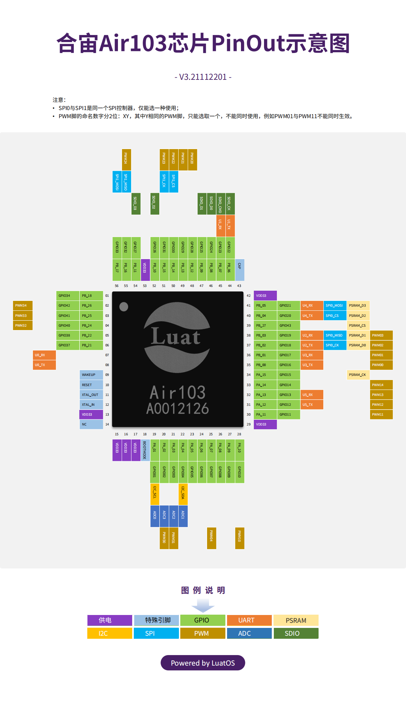
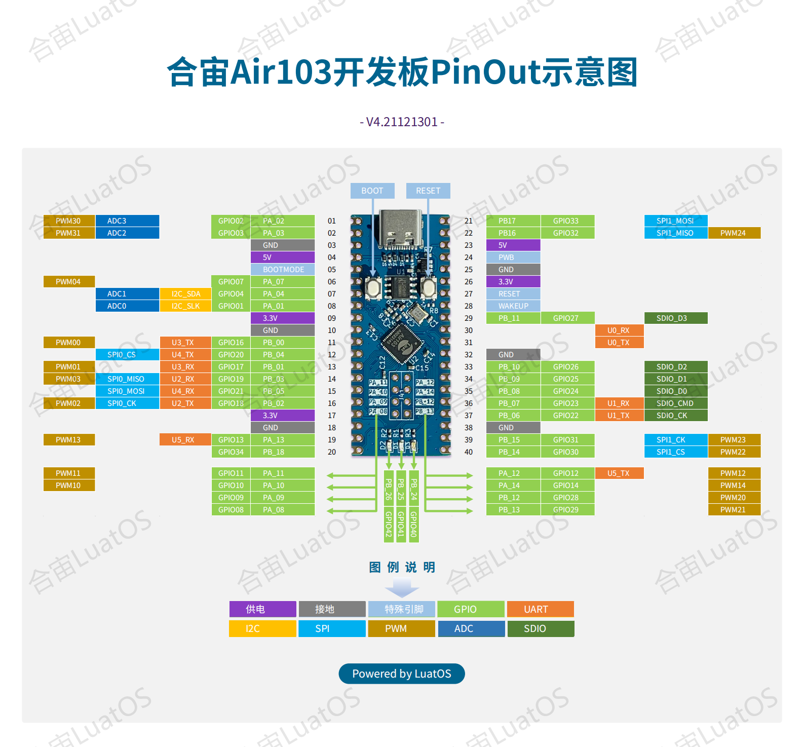

# W806-nano (Air103-nano)

The **W806-nano** (also sold as the *Air103-nano*) is an **MCU-only** board
built around the **WinnerMicro W806 / Air103** SoC �the 1 MB-flash member of
the W80x family. It has **no wireless** (no Wi-Fi/BLE RF) and the on-board
**PSRAM is not populated**.

## Key facts

| Aspect | Value |
|--------|-------|
| SoC | WinnerMicro W806 / Air103 (QFN56, 6×6 mm) |
| CPU | 32-bit C-SKY XT804, up to **240 MHz** (`-mcpu=ck804ef`) |
| Memory | **1 MB SPI flash**, 288 KB RAM (160 KB SRAM + 128 KB DRAM) |
| Wireless | **None** (MCU-only, no RF) |
| PSRAM | On-board PSRAM **not populated** |
| USB bridge | CH340 (Type-C), **115200 8N1** |
| Console | UART0 on PB19(TX) / PB20(RX) |
| Download mode | CH340 DTR/RTS auto-reset into W80x secboot, XMODEM (`wm.py flash`) |
| LEDs | 3 on-board LEDs on **PB24 / PB25 / PB26**, **HIGH-active** |

## Board photos






## LEDs (HIGH-active: GPIO high = LED on)

| LED | W806 pin | GPIO num |
|-----|----------|----------|
| LED1 | PB24 | `WM_GPIO_NUM_40` |
| LED2 | PB25 | `WM_GPIO_NUM_41` |
| LED3 | PB26 | `WM_GPIO_NUM_42` |

Verified from the Air103 KiCad netlist (`https://wiki.luatos.org/_static/bom/Air103.html`):
each LED's Pad1 �`GND`, Pad2 �resistor �W806 GPIO �same high-active
arrangement as the Air101/W800-nano.

```c
wm_drv_gpio_data_set(pin);   /* LED on  */
wm_drv_gpio_data_reset(pin); /* LED off */
```

## 1 MB flash �custom partition table (important)

The W806 has only **1 MB flash**, but the SDK's default partition tables
assume 2 MB (their `app` partition overflows 1 MB). Booting such an image
prints:

```
[E] (2) ptb: partition app exceeds flash size
```

Every project therefore ships a project-local `partition_table_custom.csv`
(enabled by `CONFIG_WM_PARTITION_TABLE_CUSTOMIZATION=y`):

```
# name,          offset,    size,      flag
ft,              0x0,       0x2000,    0x0
bootloader,      0x2000,    0xC000,    0x0
partition_table, 0xE000,    0x1000,    0x0
app,             0xF000,    0xE1000,   0x0
nvs,             0xF0000,   0x8000,    0x0
```

This gives the app a **~900 KB** partition (plenty �the built apps are
~75�05 KB) and leaves room for a 32 KB NVS region, all within 1 MB.

## Projects

| Project | Purpose |
|---------|---------|
| [`blink_hello`](blink_hello/) | Blink the 3 LEDs + print system frequency |
| [`dhry_240m`](dhry_240m/) | Dhrystone 2.1 @ 240 MHz |
| [`coremark_240m`](coremark_240m/) | CoreMark 1.0.1 @ 240 MHz |

### Measured results (GCC 6.3.0, 240 MHz)

**`dhry_240m`** (2,000,000 runs, `register` attribute):

```
Microseconds for one run through Dhrystone: 1.465
Dhrystones per Second:                      682361.0
Score (DMIPS/MHz):                          1.618
```

**`coremark_240m`** (7200 iterations):

```
Iterations/Sec   : 661.10
CoreMark 1.0 : 661.096318 / GCC 6.3.0 -Ofast -funroll-all-loops -fgcse-sm -finline-limit=500 -fno-schedule-insns / Static
Score (CoreMarks/MHz): 2.75
```

## Dependencies

- **WM IoT SDK** (CMake-based build system, `tools/wm/wm.py`).
  On this machine: `D:\board_database\main-air101-w801\wm_iot_sdk`
  (set as the `WM_IOT_SDK_PATH` environment variable).
- **WinnerMicro CLI Compile Suite**: bundled C-SKY toolchain
  (`csky-elfabiv2-gcc`, T-HEAD C-SKY Tools V3.10.29 / GCC 6.3.0), CMake,
  Ninja, ccache and Python. On this machine: `D:\winnermicro\wmclics`.
- CH340 USB-UART driver (board console / flashing bridge).

> The older `WM_SDK_W806` (in `D:\board_database\main-air103-w806\`) is the
> pre-CMake, Makefile-based SDK for the W806. It is **not** needed �the
> `wm_iot_sdk` covers the W806 fully (build + flash + the 1 MB partition
> handling above).

## Building and flashing

Every build must run with the CLI compile suite's tools on `PATH` so that
`cmake`, `ninja`, `python` and the C-SKY toolchain resolve correctly.

**Quick way (bash / Git Bash / MSYS):**

```bash
cd w806-nano/blink_hello
../../build.sh build                 # configure + build
../../build.sh flash -p COM36         # build + flash APP ONLY (fast)
../../build.sh flash-full -p COM36    # build + FULL flash (pt + bootloader + app)
../../build.sh monitor -p COM36      # serial monitor
```

**Manual way (PowerShell):**

```powershell
# 1. Prepare the environment (once per shell)
$env:WM_IOT_SDK_PATH = "D:\board_database\main-air101-w801\wm_iot_sdk"
$tool = "D:\winnermicro\wmclics"
$env:PATH = "$tool;$tool\ccache;$tool\cmake\bin;$tool\ninja;$tool\python;$tool\python\Scripts;$tool\toolchain\csky-elfabiv2-tools\bin;$env:PATH"
$env:PYTHONPATH = "$tool\python\lib\site-packages"

# 2. Build a project
cd w806-nano\blink_hello
python $env:WM_IOT_SDK_PATH\tools\wm\wm.py build

# 3. Flash to the board (substitute the CH340 COM port)
python $env:WM_IOT_SDK_PATH\tools\wm\wm.py flash -p COM36

# 4. Watch the console output
python $env:WM_IOT_SDK_PATH\tools\wm\wm.py monitor -p COM36
```

> If you change `prj.config` (e.g. to enable a new feature), delete the
> project's `build/` folder first so the Kconfig re-runs; otherwise the old
> configuration is cached and the change is silently ignored.

Notes:

- The CH340 enumerates as a COM port; confirm the right one by resetting the
  board and watching for the W80x `Secboot V0.6` + `C` (XMODEM) handshake.
- Benchmark projects disable the hardware watchdog at startup and loop with a
  10 s pause between runs.
